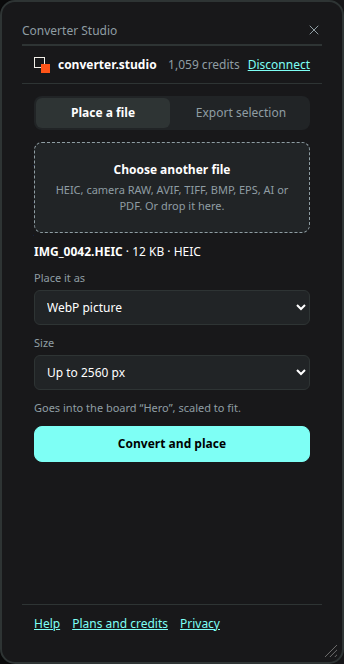
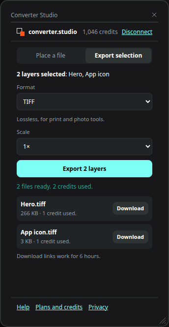

# Converter Studio for Penpot

A [Penpot](https://penpot.app) plugin for the files Penpot cannot use as they are. Place iPhone
photos (HEIC), camera RAW, AVIF, TIFF, Illustrator and EPS drawings or a page of a PDF on your
board, and export layers as what Penpot's own export cannot make: AVIF, TIFF, an ICO favicon, a
WebP or JPG under a size you choose, or a smaller PDF. The conversions run on
[Converter Studio](https://converter.studio), with your Converter Studio account's credits.



## What it does

**Place a file.** Choose a file (or drop it on the panel) and **Convert and place**:

| File                                                             | Becomes                                                              |
| ---------------------------------------------------------------- | -------------------------------------------------------------------- |
| HEIC/HEIF, camera RAW (DNG, CR2, NEF, ARW), AVIF, TIFF, BMP, ICO | a WebP, PNG or JPG image layer, up to 2560 px (or the original size) |
| Illustrator (AI), EPS                                            | editable vector layers (SVG), or a PNG                               |
| PDF                                                              | one page as a PNG, JPG or WebP (72, 150 or 300 DPI)                  |

The layer goes into the selected board (or the board around the selected layer), scaled down
to fit and centred; with nothing selected, onto the page in the middle of your view. It is one
step in Penpot's undo history. JPG, PNG, WebP, GIF and SVG files are not converted: Penpot
places those itself (drag them onto the canvas).

**Export selection.** Select up to 10 layers or boards, choose a format and **Export**.
Penpot renders each one (as PNG, at 1× to 4×, or as PDF), Converter Studio converts it, and
each result has a **Download** button (the link works for 6 hours):

| Format        | Settings                                                            |
| ------------- | ------------------------------------------------------------------- |
| AVIF          | scale, quality or lossless, "at most … KB"                          |
| WebP          | scale, quality or lossless, "at most … KB"                          |
| JPG           | scale, quality, "at most … KB" (transparent parts turn white)       |
| TIFF          | scale (lossless, for print and photo tools)                         |
| ICO (favicon) | 16, 32 and 48 px in one file, or one size up to 256 px              |
| PDF (smaller) | Penpot's PDF with its pictures compressed (light, balanced, strong) |

Penpot exports PNG, JPG, WebP, SVG and PDF itself, at a scale you choose. Use the plugin for WebP
or JPG when the file has to stay under a size, and for PDF when it has to be smaller.



Only what Converter Studio's server offers right now is shown. Conversions up to 3 credits
start on their own (a picture costs 1 credit); dearer ones show the price and ask first.

## Install and set up

1. In a Penpot file, open the plugin manager (**Ctrl + Alt + P**, or **⌘ + Alt + P** on a
   Mac) and install the plugin from this address:

   ```text
   https://converter.studio/integrations/penpot/manifest.json
   ```

   Penpot shows what the plugin asks for (see "Privacy and security") before installing it.

2. Create a Converter Studio account (free accounts get 25 credits a day) and an API key on
   your [account page](https://converter.studio/account#api-keys).
3. Open the plugin, paste the key and press **Connect**. The plugin checks it with Converter
   Studio and shows your credits.

It works on penpot.app and on self-hosted Penpot. Prices and plans:
[converter.studio/pricing](https://converter.studio/pricing).

## Limits

- One file in, one layer out; up to 10 layers per export, converted one after the other.
  Keep the panel open until it finishes.
- Penpot takes images up to 30 MB (its default; a self-hosted instance may set another
  limit). Large photos are made smaller first (2560 px by default).
- File sizes follow your Converter Studio plan.
- PSD files and video frames are not converted. The panel is in English.

## Privacy and security

- **What is sent to Converter Studio**: the file you choose to place, or Penpot's PNG or PDF
  export of the layers you choose to export, and the settings you picked. Converter Studio
  converts it and deletes the files after 6 hours. See the
  [privacy policy](https://converter.studio/privacy). Nothing else from your Penpot file is
  read or sent.
- **What the plugin may do in Penpot**: `content:read` (read the selection and export the
  layers you choose), `content:write` (add the placed image or vector layers to the file) and
  `allow:downloads` (save your exports). It does not ask for your Penpot account
  (`user:read`), libraries or comments.
- **Where the API key is kept**: in your browser, in the panel's own storage. The panel is a
  page of converter.studio shown inside Penpot, so Penpot's page and other plugins cannot read
  the key, and browsers keep it apart for each site the panel is used in (penpot.app and a
  self-hosted Penpot each ask for it once). Anyone using the same browser profile can see it
  in the developer tools. **Disconnect** deletes it; you can also delete the key on your
  Converter Studio account page at any time.
- The panel calls Converter Studio's API at `https://converter.studio/api`: the same site it
  is served from. Requests carry no cookies, and the key is never logged.

## How it is built

| Path                     | What                                                                                        |
| ------------------------ | ------------------------------------------------------------------------------------------- |
| `public/manifest.json`   | The plugin's manifest (version 2: `plugin.js`, `icon.png` and the panel resolve next to it) |
| `src/plugin/`            | `plugin.js`: runs in Penpot's sandbox with the `penpot` API; places layers and exports      |
| `src/ui/`                | The panel (`index.html`, `ui.js`): the Converter Studio API client, choices, the panel      |
| `src/shared/messages.ts` | The messages between the two, checked on arrival on both sides                              |
| `build.mjs`              | Builds `dist/` and checks it                                                                |
| `test/`                  | Unit tests with a stand-in Penpot API and a stand-in Converter Studio API                   |

Plain TypeScript and DOM, no framework, no runtime dependencies. The code is bundled with
esbuild and not minified. `plugin.js` is type-checked without the DOM's types (Penpot runs it
without a DOM, network or storage) against Penpot's official `@penpot/plugin-types`.

```sh
npm ci              # Node 22.13 or later
npm test            # unit tests (Vitest; the panel's in jsdom): no network
npm run typecheck
npm run build       # dist/: manifest.json, plugin.js, index.html, ui.js, styles.css, icon.png
node build.mjs --api http://localhost:8080/api --serve --port 4400
                    # a build against another Converter Studio API, served on
                    # http://localhost:4400/manifest.json for Penpot's plugin manager
```

The files in `dist/` are served together from one folder; the server must send
`Access-Control-Allow-Origin: *` for `manifest.json` and `plugin.js` (Penpot's page fetches
them) and must let Penpot show `index.html` in a frame.

## Support

Questions and problems: support@converter.studio or
[GitHub issues](https://github.com/tariksucu/penpot-plugin-converter-studio/issues).
More about the API: [converter.studio/developers](https://converter.studio/developers).

## License

MIT, © Converter Studio.
